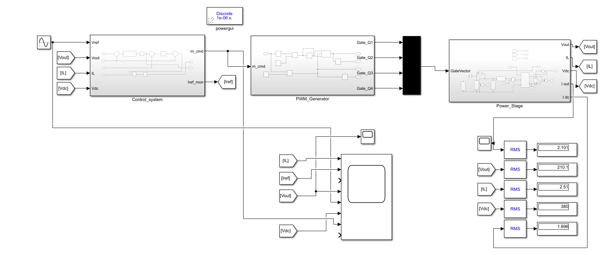
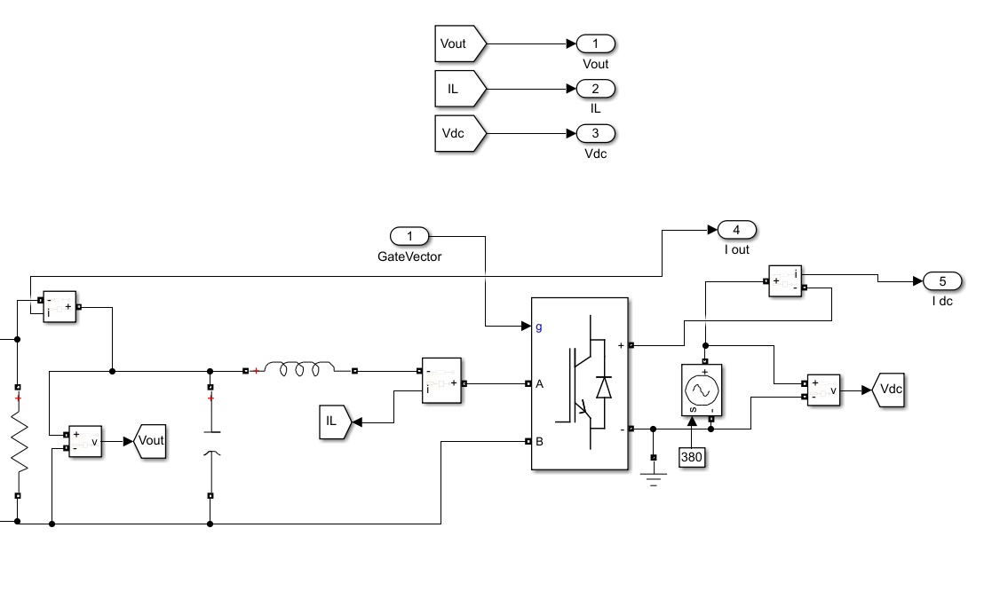
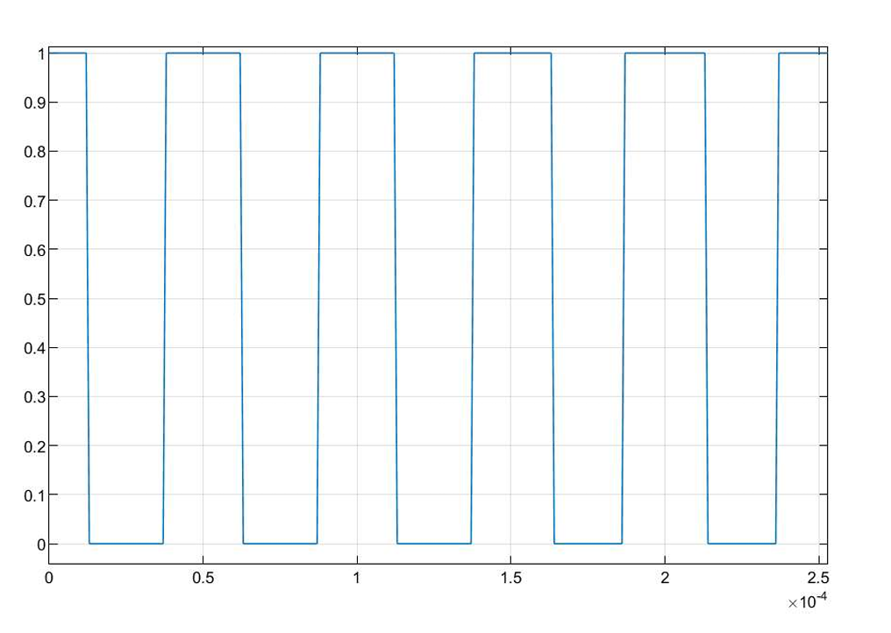
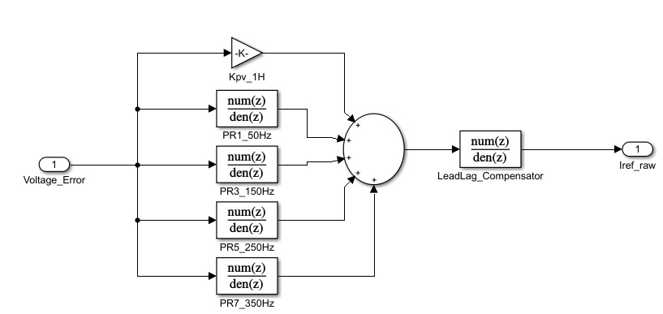
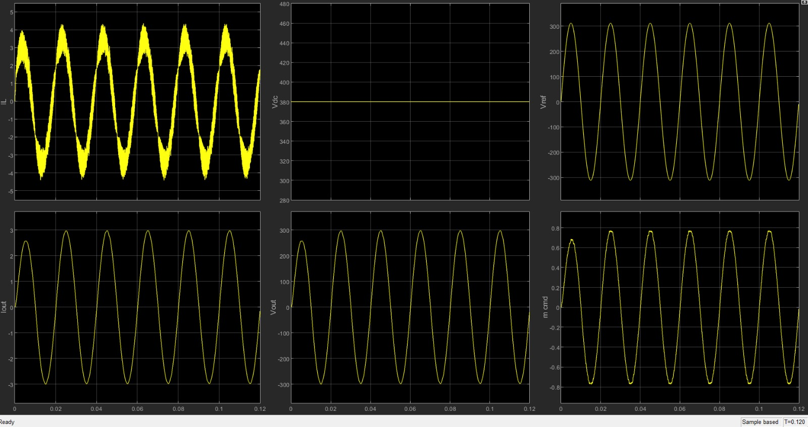
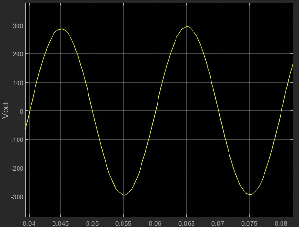

# Single-Phase DC–AC Voltage Source Inverter (Simulink)

A Simulink implementation of a single-phase full-bridge voltage source inverter (VSI) with modified-unipolar PWM, an LC output filter and cascaded PR–PI control, evaluated under fixed, switched and nonlinear loads. The design is based on the Texas Instruments reference architecture **TIDM-HV-1PH-DCAC**. Course project, Department of Electrical Engineering, IIT Bhilai (final evaluation, 11 November 2026).

> **Scope:** the project is a Simulink simulation. No physical C2000 deployment or hardware test is claimed. TI values quoted below come from the TI document and are not results from this project.



## Table of contents
- [Key specifications](#key-specifications)
- [Repository structure](#repository-structure)
- [Getting started](#getting-started)
- [Model overview](#model-overview)
- [Results](#results)
- [Comparison with the TI reference](#comparison-with-the-ti-reference)
- [Status and future work](#status-and-future-work)
- [Team](#team)
- [Reference](#reference)

## Key specifications

| Parameter | Value |
|---|---|
| DC input | 380 V |
| Topology | Full bridge, 4 IGBTs |
| Modulation | Modified unipolar PWM |
| Switching frequency | 20 kHz |
| Output filter | L = 3 mH, C = 20 µF |
| LC resonance | f₀ = 1 / (2π√LC) = 649.7 Hz |
| Output target | 220 V RMS, 50 Hz |
| Modulation index | m ≈ √2 × 220 / 380 = 0.819 (reference peak 311.1 V) |
| Base load | 100 Ω |
| Controller update | Ts = 50 µs (discrete) |

## Repository structure

```
Single-Phase-Inverter/
├── README.md
├── .gitignore
├── .gitattributes
├── simulink_model/     Simulink model (.slx)
├── docs/               Final evaluation report
└── images/             Figures used in this README
```

## Getting started

1. Clone or download this repository.
2. Open MATLAB and set the current folder to `simulink_model/`.
3. Open the `.slx` file and run the simulation.
4. View waveforms in the Scopes and RMS values in the display blocks. THD is read with Powergui FFT analysis.

## Model overview

The top-level model connects reference generation, closed-loop control, PWM, power stage and measurements.

| Subsystem | Function |
|---|---|
| `Control_system` | Cascaded control. The outer PR voltage loop generates a current reference; the inner PI current loop computes the modulation command `m_cmd` |
| `PWM_Generator` | Modified-unipolar PWM with four gate outputs (Q1–Q4) |
| `Power_Stage` | 380 V controlled DC source, Universal Bridge, LC filter, load, and sensing of Vout, IL, Vdc, Iout and Idc |

### Power stage



### Modified-unipolar PWM

Q1/Q2 are the high-frequency devices; Q3/Q4 select the output polarity at the line frequency.

| State | Q1 | Q2 | Q3 | Q4 | Bridge output |
|---|---|---|---|---|---|
| Positive, active | ON | OFF | OFF | ON | +Vdc |
| Positive, zero | OFF | ON | OFF | ON | 0 |
| Negative, active | OFF | ON | ON | OFF | −Vdc |
| Negative, zero | ON | OFF | ON | OFF | 0 |

| Gate pulse example | Unfiltered full-bridge output |
|---|---|
|  |  |

### Control

The outer voltage compensator is a proportional gain plus four parallel PR branches (50, 150, 250 and 350 Hz) followed by a lead-lag stage. Its output is the current reference, with an initial limit of ±5 A. The inner discrete PI current loop uses Vout and Vdc feedforward and divides by Vdc to give `m_cmd`.



This is a Simulink implementation inspired by the TI control diagram. It is not equivalent to TI firmware, and the coefficients were selected and tested in this model.

## Results

### Waveforms



The output is approximately sinusoidal at 50 Hz with visible high-frequency inductor-current ripple, and the DC bus stays at about 380 V. The scope capture and the RMS dashboard below are separate run snapshots.

### Load step: 100 Ω → 100 Ω ∥ 560 Ω → 100 Ω

A 560 Ω branch is switched in parallel with the base 100 Ω resistor, giving Req = 84.85 Ω while it is connected.

| Interval | Load | Power at 220 V RMS |
|---|---|---|
| 0–40 ms | 100 Ω | 484 W |
| 40–80 ms | 100 Ω ∥ 560 Ω | 570.4 W |
| 80–120 ms | 100 Ω | 484 W |

These power levels assume a regulated 220 V RMS output and ideal resistors. They are calculated, not measured.

| Load-step scope | Zoomed output voltage |
|---|---|
|  |  |

### Linear load: 100 Ω resistive snapshot

| Quantity | Value |
|---|---|
| Vout (RMS) | 210.1 V |
| Iout (RMS) | 2.101 A |
| IL (RMS) | 2.51 A |
| Vdc | 380 V |
| Idc (displayed RMS) | 1.896 A |
| Pout = Vout² / R | 441.42 W |
| Apparent power S | 441.42 VA |
| Power factor | ≈ 1.00 |
| Voltage deviation from 220 V | −4.50 % (−9.9 V) |
| Voltage THD | 0.49 % |
| Input power (as reported) | 720.86 W |
| Efficiency (as reported) | 61.23 % |

Input power and efficiency are listed as in the report for this 100 Ω case. They are marked pending validation, because `Idc` is displayed as an RMS value and average DC input power is needed for a final figure.

### Nonlinear load (rectifier–capacitor)

| Condition | Voltage THD |
|---|---|
| Nonlinear load only | 4.6 % |
| With second parallel load branch | 0.46 % |

This is a reported 90 % relative reduction ((4.6 − 0.46) / 4.6). The load network changed when the branch was switched on, so the result should not be attributed to the controller alone. THD and efficiency are specific to the load condition they were measured under, so figures from different loads should not be mixed.

## Comparison with the TI reference

TI data point: TIDM-HV-1PH-DCAC, 220 V RMS output, SDFM-based sensing, 480.03 W (TI Table 6).

| Metric | This model (100 Ω snapshot) | TI hardware |
|---|---|---|
| DC input voltage | 380 V | 382.8 V |
| Output voltage (RMS) | 210.1 V | 218.16 V |
| Output current (RMS) | 2.101 A | 2.2003 A |
| Output real power | 441.42 W | 480.03 W |
| Input power | 720.86 W (pending validation) | 489.984 W |
| Voltage THD | 0.49 % | 0.25 % |
| Efficiency | 61.23 % (pending validation) | 97.97 % |

TI nonlinear-load hardware result: 220 V RMS, Pout = 575 W, THD = 2.6 %, efficiency = 94.5 %, load PF = 0.64 (this model's nonlinear-load figures are the 4.6 % and 0.46 % above).

The comparison is informative but not like-for-like: the model's output is below the 220 V reference with about 8 % less output power than the selected TI point, and test conditions (voltage, output power, rectifier/capacitor/load values, FFT bandwidth) differ.

## Status and future work

Completed in simulation: power stage, modified-unipolar PWM, PR–PI control, switched-load and nonlinear-load tests. Partially complete: power quality and efficiency quantification.

Next steps from the report:

- Capture average input power `mean(Vdc × Idc)` and calculate efficiency
- Capture linear-load THDv, THDi, loop margins and load-step settling time
- Add realistic IGBT/diode, inductor copper and capacitor ESR losses
- Verify dead time, current limits and modulation saturation
- Match the TI nonlinear-load configuration and FFT bandwidth for comparison
- Implement on a TI C2000 controller (sensing, discrete PR + PI with feedforward, ePWM with dead-band, trip-zone protection, isolated gate drivers, physical IGBT bridge)

## Team

- Devraj
- Ankan Mondal
- Shivam Maurya

Department of Electrical Engineering, IIT Bhilai

## Reference

Texas Instruments, *Voltage Source Inverter Reference Design (TIDM-HV-1PH-DCAC)*, TIDUAY6E, Rev. E, March 2020.
